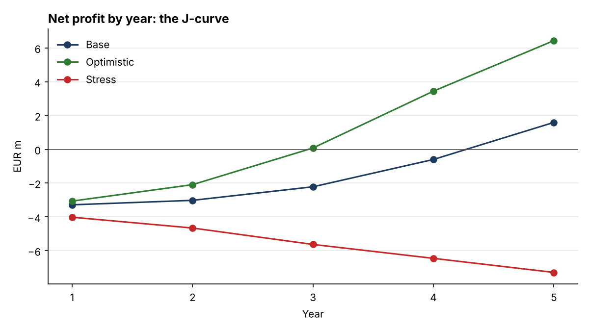
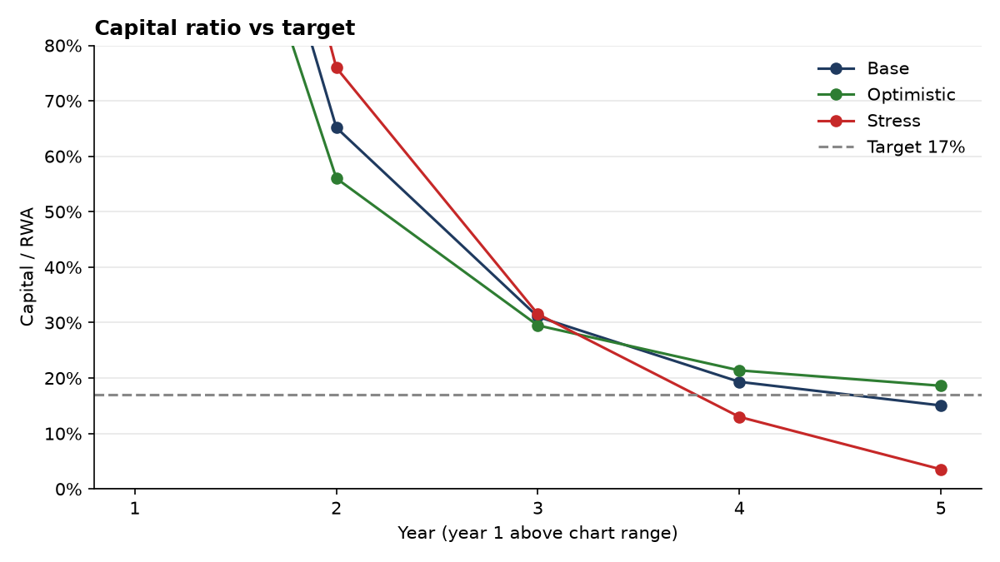

# Digital consumer lender: 5-year financial model

A transparent, scenario-based model of a **new digital bank** that offers savings deposits and unsecured consumer loans. Year 1 is funded by equity; from year 2, customer deposits fund the loan book. It answers the three questions a licence application, a board or an investor asks first:

1. **When does the bank break even?**
2. **How much capital does it need until then?**
3. **What happens if things go wrong?**

The model runs three scenarios (base, optimistic, stress), has tests for its roll-forwards and liquidity, and produces an Excel report, charts and a sensitivity analysis from a single command.

**Try it:** [interactive calculator](https://udrism-lang.github.io/bank-model/calculator/). Move the drivers and see break-even, ROE and capital change; it runs the same calculations as the Python model.

Companion projects: [bank-jurisdiction-compare](https://github.com/udrism-lang/bank-jurisdiction-compare) asks where this bank could be licensed, and [neobank-benchmarks](https://github.com/udrism-lang/neobank-benchmarks) compares it with real banks.

## Key findings

| | Base | Optimistic | Stress |
|---|---|---|---|
| Net loan book, end of year 5 | €199.2m | €241.2m | €135.0m |
| First profitable year | 5 | 3 | none |
| Cumulative net profit, 5 years | −€5.7m | +€6.2m | −€26.1m |
| ROE, year 5 | 10.5% | 21.0% | negative |
| Cost / income, year 5 | 61% | 45% | 111% |
| Cost of risk (all-in impairment charge), year 5 | 2.4% | 1.8% | 4.5% |
| Lowest capital ratio | 15.1% | 18.6% | 3.5% |
| Largest shortfall vs 17% target | −€3.1m | none | −€14.9m |
| Largest shortfall vs 15% minimum requirement | none | none | −€12.7m |

1. **The J-curve is real.** Fixed costs, acquisition costs and the build-up of the IFRS 9 loss allowance hit immediately, while interest income arrives over the life of the loan. Even the base case loses money for four years.
2. **Capital, not demand, limits growth.** Starting with €30m, the base case falls below the 17% capital target in year 5 (15.1%) and needs about **€3m of additional capital** to stay above it. Losses shrink equity while a growing loan book increases risk-weighted assets. The base case stays just above the 15% minimum requirement (by €0.1m). The stress case falls below it in year 4 and is €12.7m short of it by year 5.
3. **Three levers are close.** In the base case, a 1 percentage point change in the write-off rate moves cumulative 5-year profit by about **€4.0m**, a 1 point change in loan yield by **€4.0m**, and a 1 point change in acquisition cost by **€3.7m**. These shocks are not equally likely. A 1 point rise in write-offs is a plausible downturn outcome (the stress case assumes 2 points). A 1 point change in loan yield depends on pricing power and competition.
4. **The stress case does not survive without new capital.** A credible plan must say upfront what management would do: slow growth, reprice, cut costs, or call on shareholders.






## How it works

```
Loan book       gross: opening + originations − repayments − write-offs = closing
                allowance = coverage × closing gross loans;  net loans = gross − allowance
Funding         deposits sized to fund loans + liquidity buffer, net of equity
P&L             interest on loans and liquidity − interest on deposits
                + fees − fixed costs − acquisition − servicing − impairment − tax
                impairment = write-offs + change in allowance
Capital         equity + profit;  RWA = net loans × 75% + other assets + operational risk
                operational risk RWA = 12.5 × 12% × business indicator (CRR3)
KPIs            NIM, cost/income, cost of risk, ROE, loans/deposits, capital ratio
```

All scenario inputs live in [`assumptions.yaml`](assumptions.yaml) with a short rationale and source. A few structural choices are in the code: the capital injection year (year 3), a 0% risk weight on liquidity, and the three-year window for the business indicator.

**Cost of risk, two ways.** The input `cost_of_risk` is the write-off rate: realised losses as a share of average gross loans. The loss allowance is a fixed share of the closing gross book (`allowance_coverage`, the IFRS 9 12-month expected loss). The P&L charge is write-offs plus the change in the allowance. While the book grows, the allowance grows too, so the all-in charge is above the write-off rate: in the base case 4.0% in year 1, falling to 2.4% in year 5, against a 2.0% write-off rate. The KPI "cost of risk" in the outputs is this all-in charge. Benchmarks such as Inbank's 1.59% are all-in charges too, so compare them with the KPI, not with the input.

**Operational risk** uses the CRR3 business indicator (Articles 312-314 CRR, as amended by Regulation (EU) 2024/1623). The interest component is the lower of net interest income and 2.25% of interest-earning assets. The services component is fee income. There is no trading book, so the financial component is zero. Each part is a three-year average (fewer years in years 1-2). With a business indicator below €1bn, the capital requirement is 12% of it.

**Benchmarks used for calibration:** Inbank (Estonia) 2025 annual results — portfolio yield ~11%, cost of risk (all-in impairment charge) 1.59%, cost/income 54%, ROE 12.3%; ECB deposit facility rate 2.50% (September 2026); CRR standardised risk weight of 75% for retail exposures; CRR3 operational risk business indicator approach.

## Run it

Requires Python 3.10+.

**Windows (PowerShell):**

```powershell
.\run.ps1
```

The script creates a virtual environment on first run, installs dependencies, runs the tests and the model, and opens the `output` folder.

**Any platform:**

```bash
pip install -r requirements.txt
pytest -q
python run.py
```

Outputs in `output/`: `results.xlsx` (summary, one sheet per scenario, sensitivity), three charts, and `summary.md`.

## Project structure

```
assumptions.yaml        all inputs, per scenario, with sources
bankmodel/model.py      the projection (one year at a time, no circular references)
bankmodel/sensitivity.py one-at-a-time sensitivity on cumulative profit
bankmodel/report.py     Excel, charts, markdown summary
run.py                  command-line entry point
tests/test_model.py     roll-forwards, credit-loss and op-risk logic, reference values
docs/                   charts used in this README (copied from output/)
docs/calculator/        interactive calculator (index.html, model.js, assumptions.json)
tools/export_web_assumptions.py  writes the calculator's assumptions from assumptions.yaml
```

## Tests

The tests check that the model is internally consistent, not just that it runs:

- the gross loan book, the loss allowance and equity roll forward correctly;
- the all-in impairment rate equals the write-off rate plus the allowance build, and equals the write-off rate once the book stops growing;
- liquidity never goes negative;
- the operational risk charge follows the business indicator, and the 2.25% cap works;
- no tax is paid until accumulated losses are recovered;
- a €3.5m capital injection in year 3 closes the base-case shortfall, and €2.5m does not;
- key outputs match reference values from the current model (a regression check).

The balance sheet balances by construction, because liquidity is the balancing item. A test checks it, but it only catches coding slips. The real checks are that liquidity stays positive and that the roll-forwards hold.

### Calculator parity with Python

The calculator runs in the browser, so the model is ported line by line to JavaScript in [`docs/calculator/model.js`](docs/calculator/model.js). `bankmodel/model.py` stays the source of truth, and two test files stop the two from drifting apart:

- `tests/test_web_parity.py` runs `model.js` under Node for the three scenarios and twelve changed input sets (higher write-offs, lower yield, more or less capital, a year-3 capital injection, dearer funding, scaled origination and cost plans, and cases where the deposit floor and the 2.25% ILDC cap bind). Every yearly field and every summary value must match Python within 1e-9 relative; in practice they match exactly. The test is skipped if `node` is not installed.
- `tests/test_web_assumptions.py` checks that `docs/calculator/assumptions.json` and the fallback copy inside `index.html` (used when the page is opened from disk) match `assumptions.yaml`. After changing the YAML, run `python tools/export_web_assumptions.py`.

## Simplifications

This is a planning model, not a regulatory submission:

- annual steps with average balances, not monthly;
- a single blended loan product and a single deposit rate;
- one total capital requirement instead of separate Pillar 1, Pillar 2 and buffer layers;
- simplified tax with loss carry-forward;
- deposits are the balancing funding item; in year 1 loans are funded by equity;
- year 1 starts from zero balances, even though €30m of capital is paid in on day one. Average assets in year 1 are therefore too low, and year-1 NIM is overstated;
- a single write-off rate and a single allowance coverage rate, with no IFRS 9 stages or vintages;
- other assets are treated as tangible and risk-weighted at 100%. In practice, capitalised software is an intangible asset and is deducted from CET1, which would lower the capital ratio.

## Next steps

- Monthly granularity and vintage-based credit losses (PD curves by cohort).
- Separate savings and current-account deposits with different rates and betas.
- Liquidity coverage ratio (LCR) with run-off rates by deposit type.
- Monte Carlo on the key drivers instead of three fixed scenarios.

---

Built with AI-assisted development (Claude). Every assumption was reviewed and is documented with its rationale in `assumptions.yaml`.
