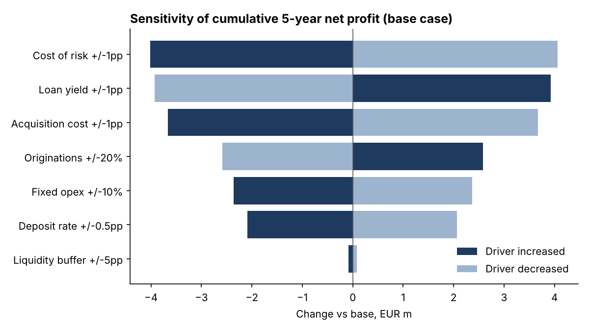

# Digital consumer lender: 5-year financial model

A transparent, scenario-based model of a **new deposit-funded digital bank** that starts with savings deposits and unsecured consumer loans. It answers the three questions a licence application, a board or an investor asks first:

1. **When does the bank break even?**
2. **How much capital does it need until then?**
3. **What happens if things go wrong?**

The model runs three scenarios (base, optimistic, stress), checks its own accounting identities with tests, and produces an Excel report, charts and a sensitivity analysis from a single command.

Companion projects: [bank-jurisdiction-compare](https://github.com/udrism-lang/bank-jurisdiction-compare) asks where this bank could be licensed, and [neobank-benchmarks](https://github.com/udrism-lang/neobank-benchmarks) compares it with real banks.

## Key findings

| | Base | Optimistic | Stress |
|---|---|---|---|
| Loan book, end of year 5 | €198.8m | €240.8m | €134.6m |
| First profitable year | 5 | 3 | none |
| Cumulative net profit, 5 years | −€7.5m | +€4.8m | −€28.0m |
| ROE, year 5 | 7.3% | 20.4% | negative |
| Cost / income, year 5 | 62% | 46% | 113% |
| Lowest capital ratio | 12.6% | 16.0% | 1.7% |
| Largest capital shortfall vs 17% target | −€7.7m | −€2.2m | −€18.2m |

1. **The J-curve is real.** Fixed costs, upfront IFRS 9 provisions and acquisition costs hit immediately, while interest income arrives over the life of the loan. Even the base case loses money for four years.
2. **Capital, not demand, limits growth.** Starting with €30m, the base case falls below the 17% capital target in year 4 and needs about **€8m of additional capital** by year 5. Losses shrink equity while a growing loan book increases risk-weighted assets.
3. **Cost of risk is the biggest lever.** A 1 percentage point change in cost of risk moves cumulative 5-year profit by about **€4m** — more than any other driver tested. Loan pricing and acquisition cost follow closely.
4. **The stress case does not survive without new capital.** A credible plan must say upfront what management would do: slow growth, reprice, cut costs, or call on shareholders.




## How it works

```
Loan book       opening + originations − repayments − credit losses = closing
Funding         deposits sized to fund loans + liquidity buffer, net of equity
P&L             interest on loans and liquidity − interest on deposits
                + fees − fixed costs − acquisition − servicing − credit losses − tax
Capital         equity + profit;  RWA = loans × 75% + other assets + 1.5 × income
KPIs            NIM, cost/income, cost of risk, ROE, loans/deposits, capital ratio
```

Every assumption lives in [`assumptions.yaml`](assumptions.yaml) with a one-line rationale and source. Nothing is hard-coded in the calculation.

**Benchmarks used for calibration:** Inbank (Estonia) 2025 annual results — portfolio yield ~11%, cost of risk 1.59%, cost/income 54%, ROE 12.3%; ECB deposit facility rate 2.50% (September 2026); CRR standardised risk weight of 75% for retail exposures; CRR3 operational risk business indicator approach.

## Run it

Requires Python 3.10+.

**Windows (PowerShell):**

```powershell
.\run.ps1
```

The script creates a virtual environment on first run, installs dependencies, runs the tests and the model, and opens the `output` folder.

**Any platform:**

```bash
pip install -r requirements.txt
pytest -q
python run.py
```

Outputs in `output/`: `results.xlsx` (summary, one sheet per scenario, sensitivity), three charts, and `summary.md`.

## Project structure

```
assumptions.yaml        all inputs, per scenario, with sources
bankmodel/model.py      the projection (one year at a time, no circular references)
bankmodel/sensitivity.py one-at-a-time sensitivity on cumulative profit
bankmodel/report.py     Excel, charts, markdown summary
run.py                  command-line entry point
tests/test_model.py     accounting identities and reference values
docs/                   charts and a companion Excel model with live formulas
```

## Tests

The tests check that the model is internally consistent, not just that it runs:

- the balance sheet balances in every year and scenario;
- the loan book and equity roll forward correctly;
- liquidity never goes negative;
- no tax is paid until accumulated losses are recovered;
- an €8m capital injection closes the base-case shortfall;
- results match the companion Excel workbook to the cent.

## Simplifications

This is a planning model, not a regulatory submission:

- annual steps with average balances, not monthly;
- a single blended loan product and a single deposit rate;
- one total capital requirement instead of separate Pillar 1, Pillar 2 and buffer layers;
- simplified tax with loss carry-forward;
- deposits are the balancing funding item; in year 1 loans are funded by equity.

## Next steps

- Monthly granularity and vintage-based credit losses (PD curves by cohort).
- Separate savings and current-account deposits with different rates and betas.
- Liquidity coverage ratio (LCR) with run-off rates by deposit type.
- Monte Carlo on the key drivers instead of three fixed scenarios.

---

Built with AI-assisted development (Claude). Every assumption was reviewed and is documented with its rationale in `assumptions.yaml`.
